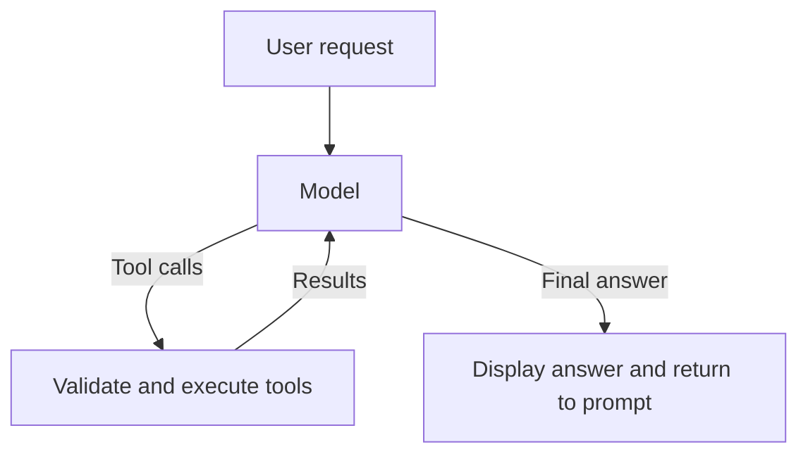

# Coding Agent

**Your agent. Your design. No surprises.**

A small Python coding agent built step by step to make its model requests,
tool execution, permissions, and control flow understandable.

The current application is an interactive, read-only assistant. It can list
workspace entries and read permitted text files through an explicit tool
dispatcher. Editing, command execution, persistent sessions, and the complete
terminal interface are later milestones.

## Setup

Requires Python 3.11+ and [uv](https://docs.astral.sh/uv/).

From the repository root:

```bash
uv sync --locked
```

Set `OPENAI_API_KEY` in your environment or a local `.env` file:

```dotenv
OPENAI_API_KEY=your-api-key
MODEL=gpt-5-mini
```

`MODEL` is optional and retains its original name after the project
rename. The current default is `gpt-5-mini`. The interactive session creates
its API client at startup, so API-key configuration is required even when
using only local slash commands. `.env` is excluded from version control.

## Usage

```bash
uv run coding-agent
uv run coding-agent --workspace /path/to/project
uv run coding-agent --help
uv run coding-agent --version
```

The workspace defaults to the directory where the command is launched.
Enter requests at the interactive prompt, for example:

```text
> List project files.
> Read README.md and pyproject.toml, then explain how to install this project.
```

| Input | Behavior |
| --- | --- |
| `/help` | Show available slash commands |
| `/status` | Show the selected workspace |
| `/exit` | End the session |
| Empty input | Show another prompt |
| Ctrl+C during input | End the session |
| Ctrl+D at an empty prompt | End the session |

Unknown slash commands are handled locally. One-shot command-line tasks are
out of scope.

## How it works



- The CLI owns one API client and reuses it across user requests.
- The agent loop allows five model turns by default. Its Python API accepts a
  keyword-only `max_steps` override.
- A response may request up to four tools. The dispatcher executes them
  sequentially and returns each result with its original `call_id`.
- The final permitted model turn disables tool requests. With the default
  budget, at most sixteen tool executions are allowed.
- Tool validation and filesystem failures become structured results. Model
  response IDs advance the interactive conversation after successful answers.
- Step descriptions are model-provided, with a fallback when absent. Tool logs
  show actual execution requests; descriptions alone are not execution evidence.

## File tools

`list_files` lists immediate workspace entries and skips symlinks. It is not a
recursive file search, and its listing does not filter secret filenames.

`read_file` restricts reads to permitted workspace-relative paths and file
extensions. It blocks configured sensitive names, rejects symlink traversal
when opening files, and accepts only regular UTF-8 text files up to 64 KiB.
Binary content is rejected.

Text search is the next exercise and is not yet registered as a model tool.
There are currently no model-accessible file-editing or command-execution tools.

## Project layout

```text
src/coding_agent/
    cli.py           Interactive session, banner, and argument parsing
    agent.py         Bounded model/tool loop
    tools/
        schema.py    Tool definitions supplied to the model
        files.py     File policy, reads, and tool dispatch
tests/               Offline protocol, CLI, and file-boundary checks
```

The distribution and command use `coding-agent`; Python imports use
`coding_agent`.

## Verification and learning workflow

Use `python3 -m pytest` inside the disposable Docker task sandbox. Tests use
fake model responses for offline verification. The sandbox test setup supplies
a dummy API key for CLI initialization and disables network access during tests.
Live API behavior and real-terminal rendering require separate checks.

The learner implements agent behavior; the instructor manages tests and reviews
observable results. A module is complete only after its acceptance gates and
understanding checks are satisfied.

The curriculum progresses through packaging, interactive input, the model/tool
loop, safe repository discovery, patches and Git, task sandboxing, permissions,
recovery, session memory, planning, evaluation, extensibility, and final CLI UX.
The provider abstraction and bottom-pinned input interface are deferred.
